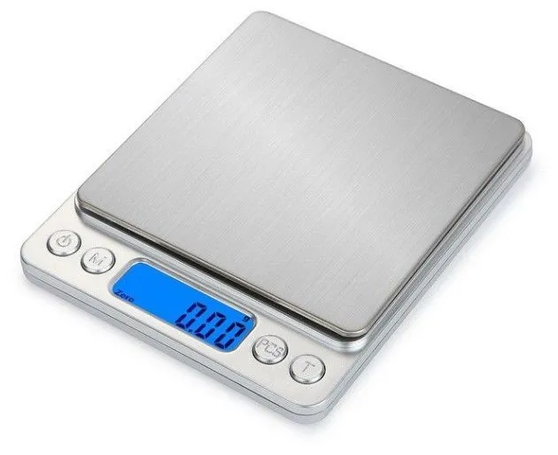
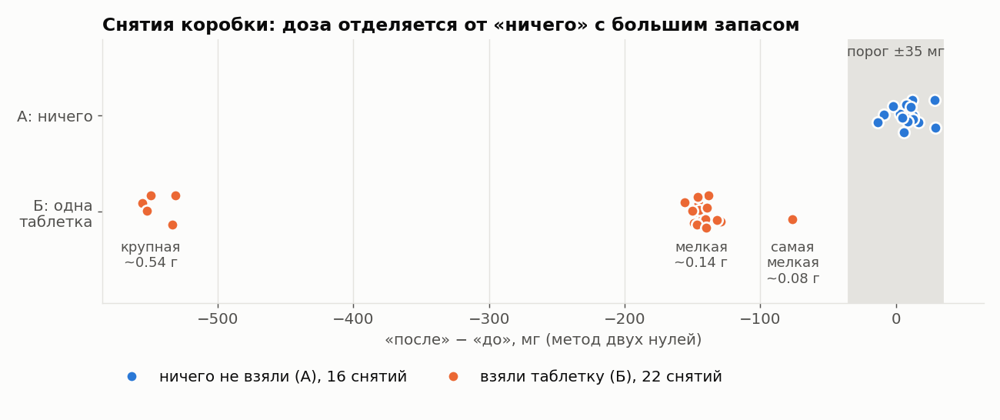

# pillscale

Платформа-весы под обычную таблетницу: по изменению веса определяет, что доза
извлечена, ведёт журнал приёмов и напоминает о приёме. Не «умная таблетница», а
**приставка, превращающая обычную таблетницу в контролируемую**: пользователь
не меняет свою коробку и привычки.

Учебный проект: подросток 15+ вместе со взрослым.



## Как это работает

- Тензодатчик из ювелирных весов (500 г × 0.01 г) и АЦП HX711 на ESP32-C3.
- Дрейф датчика больше веса таблетки, поэтому абсолютный вес не сравнивается.
  Сравнивается вес коробки **до снятия и после возврата**, с поправкой на ноль
  платформы до и после — разница в секундах, дрейф вычитается.
- Виды доз весы учат сами: новый вес — новый вид, повторился — вид подтверждён.
- Журнал событий — во флеше, время — с телефона или NTP, страница — по Wi-Fi
  самих весов, без интернета.

Главный результат измерений: «ничего не взяли» и «взяли одну таблетку» не
перекрываются — ближайшая таблетка в 13 разбросах от «ничего»
([docs/experiments.md](docs/experiments.md)).



## Документация

- Постановка и физика — [docs/project.md](docs/project.md)
- Сценарии использования, что может пойти не так — [docs/scenarios.md](docs/scenarios.md)
- Железо и распиновка — [docs/hardware.md](docs/hardware.md)
- Команды по USB и веб-страница — [docs/api.md](docs/api.md)
- План по вехам — [docs/roadmap.md](docs/roadmap.md)
- Журнал экспериментов: данные, графики, выводы — [docs/experiments.md](docs/experiments.md)

Код и комментарии — по-английски, документация — по-русски.

Полная история разработки со всеми черновиками и экспериментами — в
лабораторном репозитории [pill-scale-lab](https://github.com/Elmaranin/pill-scale-lab).

## Устройство репозитория

```
include/load_cell.h   интерфейс АЦП
src/algo/             portable C++: детектор, автомат снятий, книга доз, журнал
src/board/            драйверы ESP32-C3: HX711, USB-консоль, Wi-Fi, светодиод, зуммер
src/*.cpp             склейка: команды, калибровка, журнал, веб-страница
test/                 тесты алгоритмов на компьютере, на настоящих записях
tools/                scale.py (управление, запись), lifts.py, figures.py
docs/data, docs/img   записи экспериментов и графики из них
```

## Быстрый старт

Нужен ESP-IDF 6.1, поставленный через EIM
(`eim install -i v6.1 -t esp32c3`).

```
source ~/.espressif/tools/activate_idf_v6.1.sh   # в каждом новом терминале
idf.py build flash monitor                        # Ctrl+] — выйти из монитора
pip install -r tools/requirements.txt
python tools/scale.py cmd info
python tools/scale.py cmd tare          # пустая платформа
python tools/scale.py cmd cal 100.00    # положить груз 100 г
python tools/scale.py cmd read 50
python tools/scale.py log --minutes 10 --note "empty platform"
python tools/plot.py data/<файл>.csv
```

Тесты алгоритмов на компьютере:

```
cmake -S test -B test/build && cmake --build test/build && ctest --test-dir test/build
```

Журнал без компьютера: телефон → Wi-Fi `pillscale` (пароль `pillscale`) →
http://192.168.4.1 — состояние, события, журнал в CSV, вкладка «Весы».

Питание — только от USB-адаптера в розетку: весы непрерывно следят за дрейфом и
не могут спать ([docs/hardware.md](docs/hardware.md), «Питание»).

## Лицензия

[MIT](LICENSE)
