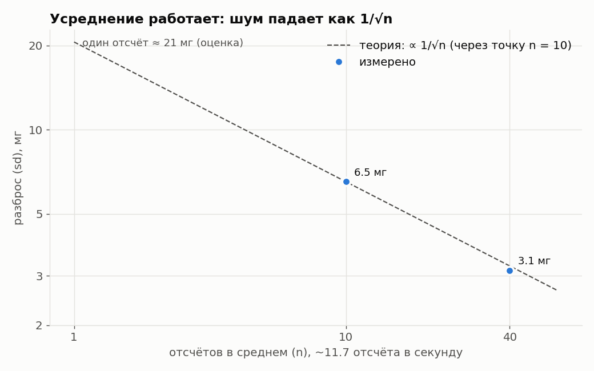
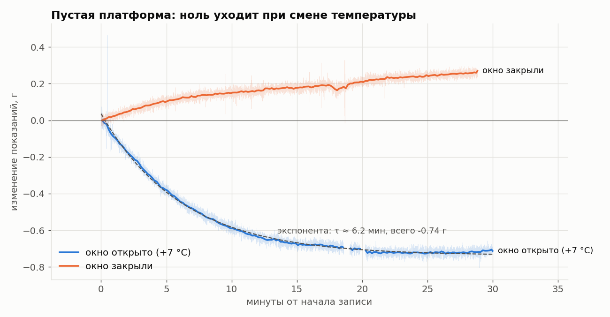
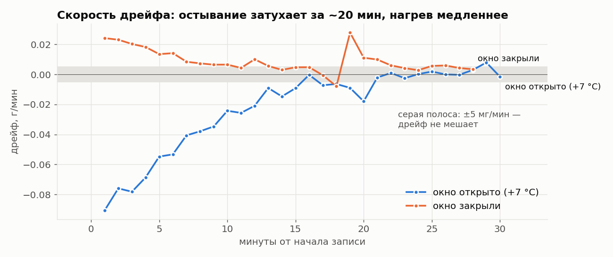
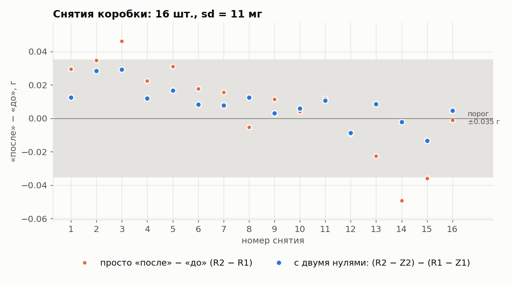
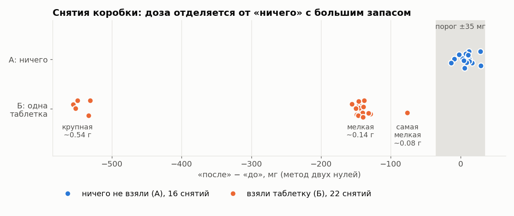
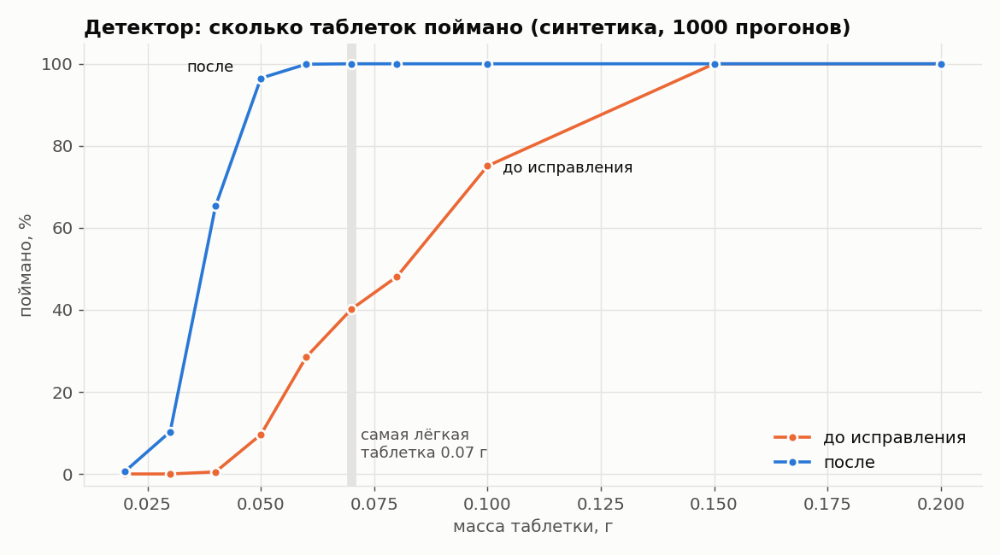
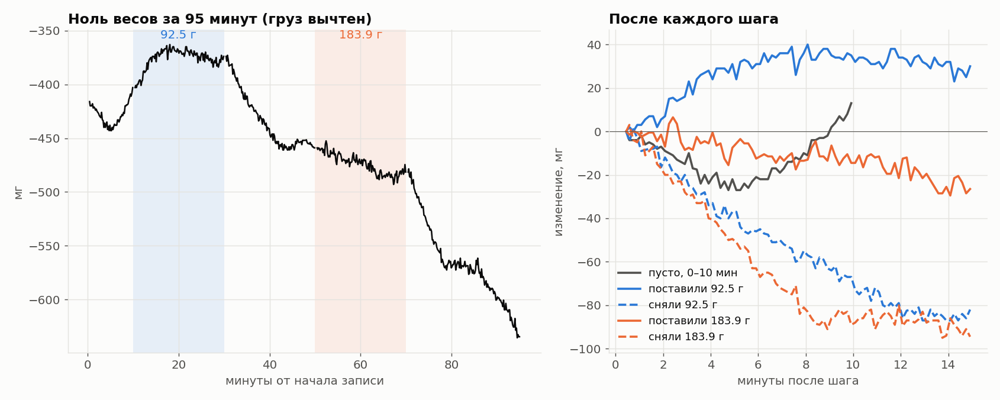

# Журнал экспериментов

Что меряли, как, что получилось и какой вывод. Отсюда берутся цифры и графики
для документации и презентации.

- Данные — `docs/data/` (в git). Рабочие записи `tools/scale.py log` ложатся в
  `data/` (в git не попадают) — удачные копировать сюда с понятным именем.
- Графики — `docs/img/`, строит `python tools/figures.py`. Новая запись в
  `docs/data/` → перезапустить скрипт.
- Новая запись в журнале — по шаблону в конце.

---

## 2026-10-17 · Шум и усреднение

**Вопрос.** Насколько «шумят» весы и помогает ли усреднение?

**Как.** Груз ~108.6 г на платформе, `stream on 10` (строка — среднее 10
отсчётов), потом `stream on 40`. Данные:
[stream_n10](data/2026-10-17_stream_n10.csv),
[stream_n40](data/2026-10-17_stream_n40.csv).



| Усреднение | Разброс (sd) | Время на одно измерение |
|---|---|---|
| 1 отсчёт (оценка) | ~21 мг | 0.085 с |
| 10 отсчётов | 6.5 мг | 0.85 с |
| 40 отсчётов | 3.1 мг | 3.4 с |

**Вывод.** Вчетверо больше отсчётов — вдвое меньше разброс, ровно как 1/√n.
Значит, шум случайный (нет медленных помех: сквозняка, вибрации, сети 50 Гц), и
усреднение его убирает. Таблетка 0.07 г больше разброса в 10–20 раз.

Попутно:

- HX711 даёт **11.7 отсчёта в секунду**, а не 10: внутренний генератор неточен
  (±20% по даташиту).
- Один мусорный отсчёт `-117 г` среди нормальных — HX711 так иногда делает.
- Сразу после установки груза показания ползут −0.012 г/мин (крип датчика),
  через несколько минут затихает. **Не отделено от дрейфа:** запись сделана до
  опыта с окном, температуру не контролировали, обратного хода после снятия
  груза не писали. Разделить — эксперимент В (план в конце файла).
  **2026-11-07, В1:** крипа такого размера нет, это дрейф.

---

## 2026-10-20 · Дрейф нуля и температура

**Вопрос.** Насколько уходит ноль пустой платформы со временем?

**Как.** Пустая платформа, `tools/scale.py log --minutes 30`. **Окно было
открыто, на улице +7 °C** — это выяснилось после. Данные:
[drift_window_open](data/2026-10-20_drift_window_open.csv) (20 479 отсчётов).





| | |
|---|---|
| Всего ушло | −0.77 г |
| Форма | экспонента, постоянная времени τ ≈ 6.2 мин |
| Скорость: в начале → через 10 → через 20 мин | −0.09 → −0.025 → −0.005 г/мин |
| Последние 10 минут | дрейф < 1 мг/мин, средние за 10 с — ±0.005 г |
| Шум одного отсчёта (пустая платформа) | 0.014 г |

**Вывод.** Ноль уходит не сам по себе, а **от смены температуры**: весы остывали
от открытого окна. Закрыли окно — пошло обратно (+0.1 г за 5 мин, запись ниже).
Через ~20 минут (3τ) после смены температуры весы снова стабильны.

Что это значит для проекта:

- При постоянной температуре дрейф за минуту без коробки ничтожен (~0.001 г).
- Сразу после смены температуры — до 0.09 г/мин: лёгкая таблетка теряется
  за минуту. Не ставить у окна, батареи, кондиционера.
- Сквозняк опаснее медленного остывания: паяные соединения датчика — термопары,
  а сигнал моста — микровольты. Нужен закрытый корпус (`scenarios.md`,
  «Устойчивость»).
- Сбой записи: два пропуска по ~25 с — компьютер засыпал. Писать через
  `caffeinate -i python tools/scale.py log ...`.

**Открытый вопрос.** Калибровка в этой записи — 2433 отсчёта/г, 17-го было
~2860 (−15%). Если калибровали тем же грузом с тем же значением — проверить,
не касается ли платформа чего-то (часть веса идёт мимо датчика).

### Окно закрыли

Сразу после первой записи закрыли окно и записали ещё 32 минуты. Данные:
[drift_window_closed](data/2026-10-20_drift_window_closed.csv) (20 265 отсчётов) —
оранжевая линия на графиках выше.

| | Окно открыто (остывание) | Окно закрыли (нагрев) |
|---|---|---|
| Направление | вниз, −0.77 г | вверх, +0.27 г за 29 мин — и ещё не кончилось |
| Постоянная времени τ | 6.2 мин | ~17 мин |
| Скорость в начале | −0.09 г/мин | +0.024 г/мин |
| Скорость в конце | < 1 мг/мин | +4.6 мг/мин |
| Шум одного отсчёта | 0.014 г | 0.012 г |

**Вывод.** Знак дрейфа меняется вместе с направлением смены температуры — это
окончательно подтверждает температурную причину. Нагрев втрое медленнее
остывания: холодный воздух из окна шёл прямо на весы, а нагрев идёт вместе с
комнатой, медленно. За 30 минут ноль вернулся только на треть (+0.27 из 0.77 г).
Значит, после проветривания весам нужен час и больше.

Около 18-й минуты — провал на ~0.03 г и возврат: вероятно, вибрация или
касание стола. Компьютер снова уснул на 3 минуты (28.8 мин) — запускать запись
через `caffeinate -i`.

---

## 2026-10-20 · Точность на известных грузах (веха 1)

**Вопрос.** Совпадают ли показания с известной массой? Критерий вехи 1 — ошибка
не больше 0.05 г.

**Как.** Эталон — показания родных весов до переделки (шаг 0.01 г). Окно
закрыто. Калибровали дважды: телефоном (220 г) и книгой (448.03 г), потом
`read 50` на остальных. Данные: [known_weights](data/2026-10-20_known_weights.csv).

| Предмет | Эталон | `cal` телефоном | `cal` книгой | «Отсчётов на грамм» |
|---|---|---|---|---|
| брусок | 64.32 г | −0.15 г | **+0.10 г** | 2867–2872 |
| зажигалка | 108.60 г | −0.38 г | **+0.09 г** | 2865–2868 |
| телефон | 220.00 г | 0 (калибровка) | **+1.22 г** | **2878** |
| книга | 448.03 г | −2.37 г | 0 (калибровка) | 2862–2863 |

Разброс одного `read 50` — 0.01–0.03 г.

**Вывод.** Критерий не пройден, но картина понятная:

- **Телефон выбивается** (+0.55% против остальных). Либо эталон «220» неточен,
  либо дело в месте: телефон и книга большие и плоские, где их центр тяжести —
  каждый раз по-разному, а дешёвый датчик показывает чуть разное в центре и на
  краю (угловая ошибка). Проверка — эксперимент Е.
- Без телефона «отсчётов на грамм» отличаются на 0.3% и чуть падают с массой —
  угловая ошибка, нелинейность датчика или неточность эталона.
- Загадка 15% снята: калибровка снова ~2860, как 17-го; 2433 было ошибкой
  калибровки, а не поломкой.
- **Для проекта абсолютная точность почти не важна.** Доза — это разность «до» и
  «после» на одной и той же коробке; 0.3% от дозы 0.07 г — 0.0002 г. Важны
  повторяемость и постановка коробки в то же место.

---

## 2026-10-20 · Угловая ошибка (эксперимент Е)

**Вопрос.** Меняется ли показание, если тот же груз поставить в другое место
платформы? Это проверка гипотезы «телефон выбивается из-за места».

**Как.** Зажигалка 108.6 г (маленькая — центр тяжести понятен): центр, потом
края/углы, `read 50` в каждом месте. Данные:
[corner_lighter](data/2026-10-20_corner_lighter.csv).

| Место | Показание | От центра |
|---|---|---|
| центр | 108.678 г | — |
| край 1 | 108.654 г | −0.024 г |
| край 2 | 108.674 г | −0.004 г |
| край 3 | 108.723 г | **+0.045 г** |
| край 4 (или снова центр) | 108.681 г | +0.003 г |

Случайная ошибка одного `read 50` — ~0.002 г (0.012 / √50), так что разница в
сотые грамма — настоящая, а не шум.

**Вывод.**

- Угловая ошибка есть, но небольшая: до ~0.05 г (0.04%) для груза 108 г на
  самом краю. Телефонные +1.2 г (0.55%) она не объясняет — скорее, неточен
  эталон «220» или телефон что-то задевал.
- Для таблетницы ~100 г: сдвинули на самый край — до ~0.05 г, а это уже
  сравнимо с дозой 0.07 г. Сдвинули на пару миллиметров — пренебрежимо. Значит,
  **угловой упор полезен**: он держит коробку в одном месте с точностью до
  миллиметров.

---

## 2026-10-21 · Снятия коробки без таблетки (серия А)

**Вопрос.** Насколько отличаются «до» и «после», если коробку сняли и вернули,
ничего не вынимая? Это ошибка, на фоне которой надо увидеть дозу.

**Как.** Пустая коробка ~27 г, без углового упора. Снимали и ставили обратно,
ничего не трогая, по протоколу из `roadmap.md` (веха 2). 20 минут записи.
Разбор — `python tools/lifts.py`. Данные:
[lifts_a_no_pill](data/2026-10-21_lifts_a_no_pill.csv).



| | С двумя нулями `(R2 − Z2) − (R1 − Z1)` | Просто «после − до» `R2 − R1` |
|---|---|---|
| Снятий | 16 | 16 |
| Разброс (sd) | **11 мг** | 26 мг |
| Худшее | +29 мг | −49 мг |
| Вне порога ±35 мг | **0** | 4 |

**Вывод.**

- **Метод двух нулей работает на настоящих данных:** разброс меньше в 2.3 раза,
  все 16 снятий внутри порога. Простое сравнение «после − до» дало бы 4 ложных «приёма».
- Против дозы 0.07 г: «ничего не взяли» — 0 ± 11 мг, доза — около −70 мг, это
  ~6 разбросов. Похоже, гистограммы не перекроются — проверит серия Б.
- Худшее снятие — №14: перед ним на платформу **надавили ~1 кг** (см. ниже),
  ноль после этого уполз на −47 мг. Просто «после − до» — −49 мг, с двумя нулями — −2 мг:
  метод убрал и это.
- Ноль за первые 10 минут поднялся с −0.16 до +0.35 г — весы снова
  прогревались (комната или недавнее включение). Методу не помешало.
- Запланировано 20 снятий, сделано 16 — для оценки хватает.

**Внимание: перегрузка.** На 12.6 мин — 1002 г, вдвое больше предела датчика
(500 г), видимо, нажали рукой, снимая коробку. Ноль потом вернулся, но так можно
погнуть датчик навсегда. Нужен механический упор под платформой (`hardware.md`,
`scenarios.md`, «Устойчивость», п. 3).

---

## 2026-10-21 · Снятия с таблеткой (серия Б) — главный результат вехи 2

**Вопрос.** Отличается ли «взяли таблетку» от «ничего не взяли»? Это и есть
вопрос «вообще получится ли».

**Как.** Та же коробка, тот же протокол, но при каждом снятии вынимали одну
таблетку. В коробке оказалось два вида таблеток. Данные:
[lifts_b_one_pill](data/2026-10-21_lifts_b_one_pill.csv).



| | Снятий | Среднее | Разброс (sd) |
|---|---|---|---|
| А: ничего не взяли | 16 | +8 мг | 11 мг |
| Б: мелкая таблетка | 16 | **−143 мг** | 7 мг |
| Б: крупная таблетка | 5 | **−544 мг** | 11 мг |
| Б: самая мелкая таблетка (снятие №12) | 1 | **−76 мг** | — |

**Вывод: работает.** Самая близкая к нулю таблетка (−129 мг) — в 13 разбросах
серии А от «ничего»; ни одно снятие серии А не вышло за ±35 мг, ни одно снятие с
таблеткой не попало внутрь. **Критерий вехи 2 выполнен:** группы не
перекрываются, с большим запасом.

- Разброс мелкой таблетки (7 мг) включает и разницу масс самих таблеток — то
  есть весы различают даже это.
- Дрейф нуля за время снятий — меньше 0.015 г (температура была стабильна),
  поэтому здесь простое сравнение дало почти то же самое. В серии А, где ноль
  гулял, — нет.
- Снятие №12, −76 мг, — **самая мелкая таблетка** (третий вид, ~0.08 г). Она в
  ~7 разбросах серии А от «ничего» и вне порога ±35 мг: даже самая лёгкая
  таблетка определяется уверенно.
- Без углового упора. Даже так хватает; упор добавит запас.

---

## 2026-10-23 · Автомат на весах: первая живая проверка

**Вопрос.** Работает ли разбор снятий в прошивке на настоящих весах, а не только
на записях?

**Как.** `event on`, коробка ~26 г, виды доз не выучены. Пять снятий: мелкая
таблетка, мелкая, крупная, **две мелкие сразу**, ничего. Лог:
[event_log](data/2026-10-23_event_log.txt).

| Снятие | Изменение | Разбор весов | Верно? |
|---|---|---|---|
| 1 | −0.131 г | новый вид 1 | ✓ первая мелкая |
| 2 | −0.122 г | доза вида 1, видели 2 раза | ✓ вид подтверждён |
| 3 | −0.548 г | новый вид 2 | ✓ крупная |
| 4 | −0.265 г | **двойная доза вида 1** | ✓ 2 × 0.127 = 0.254 |
| 5 | +0.012 г | ничего | ✓ |

**Вывод.** Все пять — верно, с первой попытки и без настройки. **Двойную дозу —
главное, ради чего проект, — весы поймали сами.** Виды доз выучились по ходу:
`doses` → `1=0.127x2 2=0.548x1`.

---

## 2026-10-23 · Взятие без снятия: первая проба — лишние 0.07 г

**Что было.** После шага 3 взяли мелкую таблетку (~0.13 г), не снимая коробку.
Весы: `E dose kind=4 n=1 g=0.198 new` — намерили на ~0.07 г больше и завели
ложный вид 4.

**Гипотеза.** Сильное нажатие на коробку при открытии/защёлкивании крышки:
датчик возвращается после нажатия медленно, а «после» берётся через ~2 с. Или
крышка смещает центр тяжести. Разбор подозреваемых — `scenarios.md`, сценарий 4.

**Дальше.** Запись: 5 взятий без снятия + 5 раз крышка без таблетки; разобрать
кривую после нажатия на компьютере.

---

## Справка · Откуда берётся дрейф

**Сначала масштаб.** HX711 при усилении 128 и питании ~3.1 В: один отсчёт АЦП —
~1.44 нВ. При калибровке 2433 отсчёта/г это значит:

| | Сигнал на входе HX711 |
|---|---|
| 1 г | **~3.5 мкВ** |
| таблетка 0.07 г | **~0.25 мкВ** — четверть миллионной доли вольта |

Всё, что сдвигает сигнал на доли микровольта, выглядит как таблетка. Поэтому
дрейф — главный враг, а не шум.

| # | Причина | Что происходит | В наших данных | Величина |
|---|---|---|---|---|
| 1 | **Смена температуры** | Ноль моста зависит от температуры: четыре тензорезистора не одинаковы, дешёвая компенсация частичная | **да:** открытое окно, −0.77 г | обычно 0.1–0.3 г на 10 °C для датчика 500 г |
| 2 | **Неравномерная температура (сквозняк)** | Одна сторона датчика или одна пайка холоднее другой. Стык разных металлов — **термопара** (медь–припой: единицы мкВ/°C) | вероятно, часть п. 1 | **0.1 °C разницы между пайками ≈ 0.1 г** |
| 3 | **Крип** | Металл и клей тензорезисторов дотягиваются минутами после смены нагрузки; после снятия — обратно | **да:** −0.012 г/мин после установки 108 г | ~0.02–0.05% нагрузки за 30 мин; при каждом снятии коробки |
| 4 | **Прогрев после включения** | Греются ESP32, HX711 и сам мост (~9 мВт) | ещё не проверяли | вероятно, десятые грамма за первые 10–30 мин |
| 5 | **Механические напряжения** | Ослабевают винты, «плывёт» пластик, корпус расширяется от тепла, тянет кабель, платформа касается чего-то | **подозрение:** ноль прыгал на граммы между сессиями, калибровка −15% | до граммов и **не затухает** |
| 6 | **Влажность** | Подложка тензорезисторов впитывает влагу | нет | медленно, часы–дни |
| 7 | **Электрика** | Утечка по остаткам флюса во влажном воздухе, треснувшая пайка | нет | случайные скачки |

**Не причина — напряжение USB.** HX711 меряет отношение сигнала моста к тому же
напряжению, которым мост питается; колебания питания сокращаются.

**Что с этим делать:**

- **1–2, температура** — место без окна, батареи и кондиционера; закрытый корпус
  вокруг датчика и HX711; провода парами вплотную. Позже — датчик температуры и
  программная поправка.
- **3, крип** — заложен в физику, только переждать: «после» мерить через 10–30 с
  после возврата коробки (эксперимент В в `scenarios.md`).
- **4, прогрев** — в жизни устройство включено всегда; перед демонстрацией
  включить заранее, минут за 30. Проверить одной записью.
- **5, механика** — самое опасное: остальное затухает, это нет. Проверить зазоры
  платформы и кабели.

**Главная мысль проекта как раз против дрейфа:** сравнивать «до» и «после» с
разницей в секунды и брать свежий ноль при каждом снятии коробки. Шум у весов уже
хороший — бороться надо с медленным.

---

## Справка · Дрейф не ограничивает время без коробки

**Вопрос.** Раз ноль уходит, сколько коробка может отсутствовать, пока человек
пьёт таблетку, чтобы весы ещё увидели разницу?

**Ответ: дрейф нуля — не ограничение.** Пока коробки нет, пустая платформа сама
показывает, куда ушёл ноль. Берём два нуля — сразу после снятия и прямо перед
возвратом:

```
вес ▲ ──R1─┐                    ┌─R2──
    │      │  Z1 ~~~~~~~~~~ Z2  │       Z1, Z2 — пустая платформа
    │      └────────────────────┘
    └──────────────────────────────► t

d = (R2 − Z2) − (R1 − Z1)
```

Каждая скобка — вес коробки относительно нуля, измеренного **в пределах
нескольких секунд**. Весь дрейф нуля между Z1 и Z2 вычитается — минута прошла
или час. **Мы не боремся с дрейфом, а измеряем его и вычитаем.**

Что остаётся:

| Остаток | Почему | Величина |
|---|---|---|
| Дрейф за два перехода (снятие, возврат) | всего ~2–3 с каждый | ~0.005 г даже при открытом окне (0.09 г/мин) |
| **Крип** | чем дольше датчик разгружен, тем сильнее он «отходит», а после возврата снова дотягивается | ~0.01–0.02 г, растёт с паузой. **Главный остаток** |
| Дрейф чувствительности | температура меняет не только ноль, но и «отсчётов на грамм»: ошибка ∝ весу коробки | ~0.002–0.005 г на 1 °C для коробки 100 г |

Против таблетки 0.07 г (порог 0.035 г) минутная пауза укладывается с запасом.
Время без коробки ограничивает крип и сильная смена температуры за паузу, а не
дрейф нуля. Крип на длинных паузах — эксперимент В в `scenarios.md`.

Подробно, в контексте сценариев, — `scenarios.md`, сценарий 3. Текущий `detect`
так ещё не считает; правильная схема — в автомате вехи 4.

---

## Детектор «положили / сняли» (синтетика)

**Вопрос.** Сколько таблеток ловит `detect` в зависимости от массы?

**Как.** На компьютере: шум как у этих весов (0.02 г на отсчёт), таблетка
садится в случайный момент посреди блока за ~0.3 с, по 1000 прогонов на массу.
Две версии алгоритма: первая (коммит `241c582`) и исправленная (`f619f4c`).
Данные: [detector_sim](data/detector_sim.csv).



| Масса | Первая версия | Исправленная |
|---|---|---|
| 0.03 г (должна игнорироваться) | 0% | 10% |
| 0.05 г | 10% | 96% |
| **0.07 г** | **40%** | **100%** |
| 0.10 г | 75% | 100% |
| Ложные события за ~33 ч шума и дрейфа | 0 | 0 |

**Вывод.** Первая версия «съедала» лёгкую таблетку по кусочкам: опорный вес
переезжал на каждый установившийся блок, а таблетка, упавшая посреди блока,
делилась на два шага меньше порога. Исправление: опорный вес следует за дрейфом
медленно (~20 с), а блоки с другим весом его не двигают. Нашли, потому что на
реальных весах не ловилась таблетка 0.07 г, а тесты с шагом ровно на границе
блока этого не видели.

**Ограничение.** Это синтетика. На записях с реальной таблетницей (веха 2)
проверить ещё раз.

---

## 2026-11-07 · Крип против дрейфа: ступени груза (эксперимент В1)

**Вопрос.** Есть ли у датчика крип, который можно отличить от дрейфа и
поправлять (план — ниже, «План · Крип или дрейф»)?

**Как.** `tools/scale.py creep 1 --w1 92.53 --w2 183.94`: пусто 10 мин → груз
92.53 г 20 мин → пусто 20 мин → груз 183.94 г 20 мин → пусто 25 мин. Весы
включены за час до начала. Температуру не записывали. Данные:
[creep_v1](data/2026-11-07_creep_v1.csv) (66 827 отсчётов, без пропусков).
График — `python tools/figures.py`.



Слева — ноль весов за всю запись: груз вычтен, каждый отрезок пристыкован к
предыдущему (важна форма, а не уровень). Справа — каждый отрезок от своего
начала. Будь это крип, сплошные линии (поставили) шли бы вверх, пунктир (сняли)
зеркально вниз, а оранжевые были бы вдвое дальше от нуля, чем синие.

| Величина | Значение |
|---|---|
| Шум одного отсчёта | 12–15 мг, как раньше |
| Частота отсчётов на деле | 11.7 в секунду (по даташиту 10, внутренний генератор HX711) |
| Ноль за 95 минут | −0.42 → −0.64 г, в среднем −2.3 мг/мин, неравномерно |
| Пусто, минуты 0–10 | −25 мг, потом +35 мг — ноль гуляет и без груза |
| Поставили 92.5 г (0.5 → 12 мин) | +35 мг; подъём начался за 4 мин до груза |
| Поставили 183.9 г | −15…−25 мг — знак обратный |
| Сняли 92.5 г | −85 мг за ~10 мин, τ ≈ 4–5 мин |
| Сняли 183.9 г | −85 мг за ~10 мин — так же, как после вдвое меньшего груза |
| Первая минута после любого шага | в пределах ±20 мг, быстрой части нет |
| Подгонка «дрейф + крип» | крип 0.06 % для 92.5 г и 0.025 % для 183.9 г — не совпадает |

**Вывод.** Крип **не выделился**: сползание не пропорционально грузу и не
зеркально. По таблице решений из плана — это не крип. Если крип есть, он не
больше ~0.03 % груза (~50 мг на 184 г), в комнате его перекрывает дрейф.

Повторилось только одно: **после снятия груза ноль уходит вниз на ~85 мг за
10 минут** — оба раза одинаково, хотя груз отличался вдвое. Для крипа так не
бывает. Тепло руки отпадает: груз снимают меньше чем за секунду, и при
постановке руку тоже подносят, а такого следа нет. Остаются две версии:

- **Механика корпуса.** Пластик, напечатанный на 3D-принтере, под нагрузкой
  медленно проседает и после снятия так же медленно распрямляется. Если корпус
  или крепёж датчика хоть немного поджимает балку, ноль поплывёт, и почти
  одинаково при любом грузе, раз пластик упирается в один и тот же зазор. Так
  же действует трение в винтах крепления.
- **Совпадение с общим ходом дрейфа.** Ноль шёл вниз всю вторую половину записи.

Проверить: 3–4 цикла «поставили — сняли» подряд. Если после каждого снятия
повторяется −85 мг, а пустая платформа между циклами стоит ровно, виновата
механика. Тогда сравнить с датчиком, снятым с корпуса и закреплённым на
жёсткой металлической или деревянной основе.

Что это значит для проекта:

- Поправка на крип в прошивке **не нужна**. Метод двух нулей сравнивает вес в
  пределах секунд. Самое быстрое сползание здесь — около −10 мг/мин, то есть
  ~5 мг за 30 с без коробки, и его вычитают два нуля. До порога 35 мг большой
  запас.
- Цифра −0.012 г/мин от 2026-10-17 — это дрейф того же размера, что здесь, а не
  крип.
- Решающий опыт — **В2** с настоящей коробкой: он прямо меряет ошибку «после» от
  времени без коробки.
- Если повторять В1: с термометром, ночью, когда комната не меняется, с грузами
  300–400 г (датчик на 500 г) — крип растёт с грузом, дрейф нет. И 3–4 цикла
  «поставили — сняли», а не два.

---

## План · Крип или дрейф (эксперимент В)

В1 проведён 2026-11-07 (запись выше): крип не выделился из дрейфа. В2 — ещё нет.

**Вопрос.** Можно ли отличить крип от дрейфа нуля и, если крип предсказуем,
поправлять на него вес коробки «после» — для более точного разбора?

**Зачем.** Метод двух нулей вычитает дрейф нуля, но не крип: крип возникает как
раз тогда, когда коробку снимают и ставят. В «Справке · Дрейф не ограничивает
время без коробки» крип назван главным остатком ошибки после долгого
отсутствия коробки. Единственная цифра (−0.012 г/мин, 2026-10-17) может быть
смесью крипа и дрейфа.

**Чем они отличаются** (это и проверяем):

| Признак | Крип | Дрейф нуля |
|---|---|---|
| Когда начинается | сразу после того, как груз поставили или сняли | когда меняется температура, в любой момент |
| От чего зависит размер | от груза: тяжелее груз — больше сползание | от температуры, от груза не зависит |
| Пустая платформа после снятия груза | ползёт обратно к прежнему нулю, зеркально, и затихает | ползёт и без груза, к прежнему нулю сама не возвращается |
| Повтор в тех же условиях | повторяется | зависит от погоды в комнате |

### Условия

- Окно закрыто, батарея и солнце не рядом, температура в комнате без перемен
  **не меньше часа**; если есть термометр — записать показания в начале и в конце
- Весы включены не меньше 30 минут (иначе примешается прогрев, эксперимент Ж)
- Таймер под рукой: действия — ровно на отметках, указанных ниже
- Ноутбук не засыпает: `caffeinate -i`

**Подсказки и зуммер.** Режим `creep` пишет тот же CSV, что `log` (сырые
отсчёты), и ведёт по сценарию: за 10 с до шага — короткий сигнал и текст в
терминале, за 3-2-1 с — тики, в момент шага — длинный высокий сигнал и
«СЕЙЧАС: …». Через 15 с проверяет вес: не тот (забыли поставить, поставили не
то) — три низких сигнала и предупреждение. Каждый шаг — строка `# mark` в CSV
с `t_ms` весов: по ним анализ находит ступени. Сначала — репетиция без грузов,
сценарий в 10 раз быстрее: `python tools/scale.py creep 1 --speed 10`.

### В1. Ступени груза: крип против дрейфа

Грузы: зажигалка 108.60 г, зажигалка + брусок 172.92 г (в 1.6 раза тяжелее).
Подойдут **любые** два груза: крип видно по форме кривой, точная масса не нужна.
Лучше вдвое тяжелее один другого, 80–250 г, металл, стекло или пластик — не вода,
не еда, не бумага (масса меняется от влажности). Свои грузы — взвесить на вкладке
«Весы» и передать: `creep 1 --w1 95.3 --w2 190.1` — по ним проверяется, тот ли
груз поставили. Одна непрерывная запись, сырые отсчёты:

```
caffeinate -i python tools/scale.py creep 1 --note "комната 22 °C"
```

| Минута | Действие |
|---|---|
| 0–10 | пустая платформа — проверка, что дрейфа нет |
| 10 | поставить зажигалку в центр |
| 30 | снять |
| 50 | поставить зажигалку + брусок в центр |
| 70 | снять |
| 95 | конец записи |

Что считать:

- Сползание после каждой постановки и обратный ход после каждого снятия:
  подогнать `x(t) = A · (1 − e^(−t/τ))`, получить размер `A` и время `τ`.
- `A / груз` для двух грузов — если крип, должно совпасть (`A` в 1.6 раза больше
  для тяжёлого груза), `τ` — одинаковое.
- Обратный ход после снятия — по размеру такой же, как сползание после
  постановки, со знаком наоборот.
- Ноль в конце записи против нуля на минутах 0–10: сдвиг — это дрейф, его
  вычесть перед подгонкой.

### В2. Настоящая коробка: ошибка «после» от времени без коробки

Таблетница (~20 г) стоит на весах не меньше 30 минут. Ничего из неё не брать.
Одна запись:

```
caffeinate -i python tools/scale.py creep 2 --note "комната 22 °C"
```

| Минута | Действие |
|---|---|
| 0–30 | коробка стоит |
| 30 | снять на 10 с, вернуть |
| 35 | снять на 1 мин, вернуть |
| 41 | снять на 5 мин, вернуть |
| 56 | снять на 30 мин, вернуть |
| 86–100 | коробка стоит, конец записи |

Что считать (`tools/lifts.py` по каждому снятию + кривая после возврата):

- изменение `d` по двум нулям, когда «после» взято, как в прошивке (через ~3 с
  после возврата), и когда через 30 с и через 2 мин;
- кривую веса коробки первые 5 минут после возврата.

### Что решаем по результату

| Результат | Решение |
|---|---|
| Сползание пропорционально грузу, зеркально, повторяется | Это крип, он предсказуем |
| Ошибка «после» даже после 30 мин без коробки меньше ~5 мг | Ничего не менять: порог 35 мг с запасом |
| Ошибка больше, но затихает за 10–30 с | Брать «после» позже, через 10–30 с после возврата |
| Ошибка заметная и предсказуемая | Поправка в прошивке: `ошибка ≈ k · вес коробки · (1 − e^(−t_без/τ))`, `k` и `τ` — из В1 и В2; проверить на записях серий А и Б и на неделе |
| Сползание не пропорционально грузу или не повторяется | Это не крип: искать дрейф (температура) или механику (`Справка · Откуда берётся дрейф`, п. 5) |

Если поправка заработает, весы станут точнее на долгих отлучках коробки, и
можно попробовать снизить порог «ничего не взяли» ниже 35 мг — это следующий
опыт на сериях А и Б.

---

## Шаблон записи

```
## ГГГГ-ММ-ДД · Название

**Вопрос.** Что хотим узнать — одной фразой.

**Как.** Что стояло на весах, команды, сколько повторов, условия (окно,
температура). Данные: [имя](data/ГГГГ-ММ-ДД_имя.csv).


| Величина | Значение |
|---|---|

**Вывод.** Что это значит для проекта.
```
