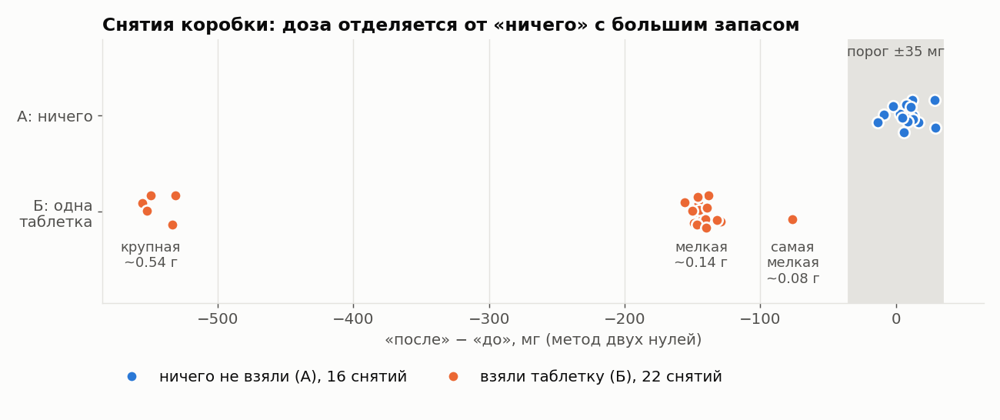

# План и итоги

Что уже сделано и с каким результатом, что осталось до первой версии и что
потом. Подробные чек-листы с датами, черновики и все промежуточные шаги — в
лабораторном репозитории
[pill-scale-lab](https://github.com/Elmaranin/pill-scale-lab).

## Сейчас

Веха 5 — расписание приёмов и веб-страница — готова и проверена на весах.
**Следующий шаг: вкладка для демонстрации** (первый пункт в «Первая версия:
что осталось»).

---

## Что сделано

### 1. Датчик жив

Тензодатчик 500 г из ювелирных весов, АЦП HX711, ESP32-C3 на ESP-IDF 6.1,
корпус напечатан на 3D-принтере (`hardware.md`). Калибровка известным грузом:
ошибка 0.1–0.4 % на компактных грузах. Шум одного отсчёта ~0.014 г, усреднение
работает как √n: 0.0065 г по 10 отсчётам, 0.0031 г по 40.

### 2. Шум и дрейф: «вообще получится ли»

Главный результат проекта. Ноль после включения оседает по экспоненте
(τ ≈ 6 мин) и сильно зависит от температуры: открытое окно сдвигает его на
десятые доли грамма. Поэтому абсолютный вес через часы сравнивать нельзя, а
вес «до снятия» и «после возврата» — можно: два свежих нуля с пустой платформы
вычитают дрейф, сколько бы коробки не было
([experiments.md](experiments.md), «Справка · Дрейф не ограничивает время без
коробки»).

| Снятия коробки | Снятий | Разброс |
|---|---|---|
| Ничего не взяли | 16 | 11 мг |
| Одна мелкая таблетка, −143 мг | 16 | 7 мг |

Распределения не перекрываются: ближайшая таблетка — в 13 разбросах от
«ничего». Порог решения — 35 мг, половина самой лёгкой таблетки (70 мг).

Эксперимент В1 (крип против дрейфа): крипа, пропорционального грузу, не нашли.
Повторилось другое — после снятия груза ноль уходит вниз на ~85 мг за 10 минут
при любом грузе; подозрение на механику корпуса.

### 3. Второй АЦП — вне первой версии

HX711 хватает: 11 мг разброса против таблетки от 70 мг. Интерфейс `LoadCell`
оставлен — NAU7802 добавляется отдельным драйвером без изменения логики.

### 4. Автомат «стоит → снята → возвращена»

- `src/algo/lift_tracker.h` — снятия и возвраты, изменение веса по двум нулям;
  на записях вехи 2 совпадает с разбором на компьютере в пределах 5 мг.
- `src/algo/dose_book.h` — весы сами учат «виды доз» и различают: ничего не
  взяли, доза, **двойная доза**, пополнение, другая коробка.
- Взял таблетку, не снимая коробку, — тоже событие (`changed`).
- Первая живая проверка: 5 снятий из 5 разобраны верно, включая двойную дозу.
  Неделя на настоящей таблетнице: все приёмы в журнале, ложных нет
  ([журнал недели](data/pillscale_log.csv)).

### 5. Журнал, время, страница, расписание — без интернета

- Журнал во флеше: ~8000 записей (около месяца), переживает отключение
  питания; время записей, сделанных до установки часов, восстанавливается.
- Своя сеть Wi-Fi `pillscale` и страница http://192.168.4.1; время приходит с
  телефона при открытии страницы. Если задана домашняя сеть — весы
  подключаются к ней и берут время с NTP сами.
- Страница: «Сводка» (коробка, ближайший приём, сегодня, неделя), «Журнал»,
  «Расписание», «Весы» (вес в реальном времени), «Настройки» со сбросом.
- Расписание: до 4 приёмов в сутки с окном; статусы «по расписанию»,
  «повторно», «вне расписания», «пропущено»; зуммер в момент приёма и каждые
  5 минут, светодиод мигает, пока доза не взята. Окна разных приёмов не
  перекрываются ([scenarios.md](scenarios.md), сценарии 8–16).
- Питание — только от сети: весы следят за дрейфом непрерывно и не могут спать.

Протокол и страница — [api.md](api.md).

---

## Первая версия: что осталось

По порядку. Каждый шаг доводится до рабочего состояния, потом следующий.

1. **Вкладка для демонстрации.** Живой график веса за последние минуты с
   отметками событий: коробку сняли, вернули, «доза −0.14 г». Рисуется
   встроенным SVG из флеша — интернета на демонстрации нет.
2. **Проверки в жизни** с несколькими таблетницами. На каждую: 10 снятий без
   таблетки, 10 — с одной, 5 взятий не снимая коробку, 1–2 дня по расписанию.
   Итог — таблица на коробку: вес коробки и доз, сколько приёмов поймано,
   ложные события, разделение «ничего» и «одна таблетка» в разбросах. Сюда же —
   открытый вопрос вехи 4: взятие без снятия показало 0.198 г вместо ~0.13
   (`scenarios.md`, сценарий 4).
3. **Расписание — доделать.**
   - Коробки нет на весах в момент приёма (сценарий 12): не пищать, пока
     коробка в руках; засчитывать дозу окну, с которым пересекается время
     отсутствия коробки; `missed` откладывать до возврата.
   - Сигнал «повторная доза», отличный от напоминания (сценарий 11).
   - Доза раньше окна (сценарий 9) — сначала посмотреть журнал реальной недели.
   - Правка расписания сбрасывает сегодняшние отметки «принято» — перечитывать
     журнал после правки.
   - Напоминания по сетке «момент + 5, 10, 15 мин», снятие коробки сетку не
     сдвигает.
4. **Проверить на весах:** кнопки сброса; не шумит ли Wi-Fi в АЦП (`stream` с
   Wi-Fi и без, сравнить sd); потребление мультиметром в разрыве USB.
5. **Документация и презентация.** Сюда же — файл 3D-модели корпуса в
   репозиторий и фото сборки в `hardware.md`.

**Критерий первой версии:** весы включили на демонстрации без сети, с телефона
открыли страницу — время установилось; в момент приёма весы пищат; приём
попадает в журнал и на сводку с правильным временем и статусом.

---

## После первой версии

- **Уведомления** (нужен интернет, только при домашнем Wi-Fi): Telegram-бот или
  ntfy.sh; эскалация — повтор через 15 мин, родственнику через 60; вечерняя
  сводка; без сети уведомления копятся.
- Модуль часов DS3231 с батарейкой: время переживает отключение питания и без
  сети — сейчас после пропадания питания напоминаний нет, пока не откроют
  страницу.
- Рамка под таблетницу и упор от перегрузки (3D-печать).
- Отчёт для врача из журнала: графики, пропуски.
- Доза по времени приёма вместо безымянных видов: «утренняя доза обычно
  0.68 г» (`scenarios.md`, «Нужны ли весам виды доз»).
- `tools/scale.py` ставит время компьютера сам при подключении.
- Классификатор событий по форме кривой веса (ML).
- Второй АЦП NAU7802: сравнить с HX711 на тех же записях; второй канал —
  миска кошки.
- Оставшиеся эксперименты из `scenarios.md`: настоящая коробка снята на
  10 с – 30 мин (В2), крышка (Г), мокрые пальцы (Д), прогрев (Ж), коробка час
  под нагрузкой.
